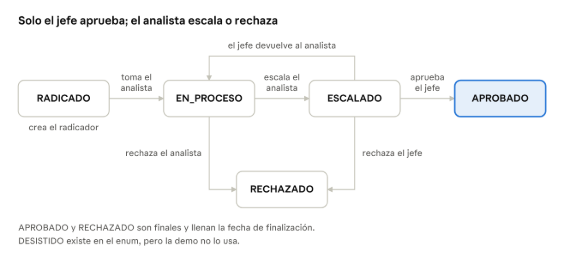

# **Preguntas técnicas Senior: Demo de ofertas sobre BRP**
Nov 17, 2026
## **Contexto y objetivo**
La Gerencia de Mejoramiento de Originación y Cobranza debe actualizar su sistema de ofertas de bienes recibidos en forma de pago (BRP). Este documento reúne las preguntas técnicas del ejercicio: cada sección plantea un reto y la pregunta que el candidato debe resolver con una demo funcional, pensada para convencer a usuarios nuevos.

Los usuarios que verán la demo son nuevos en el sistema, así que debe entenderse sin capacitación previa. Usa un backend en Java y una base de datos pequeña, y tiene cuatro módulos: radicación de ofertas sobre el catálogo de BRP, análisis para escalarlas, aprobación y seguimiento.

También se construye un frontend en Angular, pero su calificación pesa poco: déjalo para el final y basta con que sea funcional. Lo que más importa es el backend.

También debe mostrar cómo monta todo: proyecto, base de datos, migraciones y datos de ejemplo. Las tablas y campos de este documento son solo ejemplos: puedes ajustarlos mientras cumplas las reglas. Esto es una demo: no todo tiene que quedar completo, así que avanza lo que más puedas según el tiempo. La duración del ejercicio es la que se indique en el correo.
## **Pregunta 1: ¿cómo armas el stack y el arranque?**
Estas son nuestras recomendaciones de stack: úsalas. Si usas algo distinto, no hay problema, pero indícalo en el README y explica por qué. Lo único obligatorio es Postgres levantado desde Docker Compose.

|Capa|Recomendación|
| :- | :- |
|JDK|Java 21 o Java 25, con una imagen Docker como Eclipse Temurin, Corretto o IBM Semeru Runtimes|
|Backend|Spring Boot, Spring Data JPA (Hibernate), Spring Security y Bean Validation|
|Frontend|Angular 17 o superior. Prioridad baja: constrúyelo al final, y basta con que sea funcional|
|Base de datos|PostgreSQL, levantado con Docker Compose (este sí es obligatorio)|
|Migraciones|Una herramienta de migraciones versionadas, preferiblemente Liquibase: esquema, datos de ejemplo y usuario administrador inicial|
|Adjuntos|Almacenamiento local en disco; la base guarda el nombre y la ruta|
|Seguridad|Login propio con usuarios en base de datos, contraseñas con BCrypt y JWT; sin Active Directory|
|Build|Gradle 8 o superior|
|Pruebas|Pruebas unitarias pequeñas con JUnit sobre las reglas principales; no se exige cobertura mínima|
## **Pregunta 2: ¿cómo modelas y cargas el catálogo de BRP?**
El BRP es un catálogo de solo lectura: se carga con las migraciones y la gente solo lo consulta para ofertar, sin editarlo. Por eso no lleva campos de auditoría ni de versión.

|Campo de ejemplo|Idea|
| :- | :- |
|codigo|Identificador único del BRP|
|estado|Disponible, sin precio, pendiente técnico, en trámite de venta, saneamiento o dado de baja|
|tipo\_brp|Apartamento, casa, local, lote, vehículo, maquinaria|
|matricula\_inmobiliaria o placa|Según el tipo: los inmuebles llevan matrícula y los vehículos llevan placa|
|departamento, municipio|Ubicación del bien|
|descripcion|Dirección y datos propios del bien, en texto libre|
|precio|Avalúo comercial; vacío si no hay fecha de asignación|
|fecha\_asignacion\_precio|Cuándo se asignó el precio|
|año, mes y día de ingesta|Fecha de la carga, para saber qué tan reciente es el catálogo|

Reglas del modelo:

1. Si la fecha de asignación de precio es nula, el precio también es nulo y el estado queda en SIN\_PRECIO, sin importar el estado que traiga la carga. Fecha y precio nacen juntos o ambos nulos: un CHECK en la migración y la regla en el servicio de carga.
1. Matrícula y placa nunca van juntas: los inmuebles llevan matrícula, los vehículos llevan placa y la maquinaria ninguna de las dos. Se valida con un CHECK.
1. El catálogo muestra cada BRP una sola vez: si el mismo código llega en varias cargas, se muestra la versión de la ingesta más reciente, y los demás BRP aparecen todos. Un endpoint devuelve la fecha de la última actualización del catálogo, para que Angular muestre algo como "catálogo actualizado al 17 de noviembre".
### **Catálogo de ejemplo**
Recibes el archivo brp\_ejemplo.csv con 100 BRP ficticios: 25 apartamentos, 20 casas, 15 locales, 12 lotes, 18 vehículos y 10 maquinarias. Las columnas coinciden con los campos del modelo. Debes cargarlo al arrancar la aplicación con tu herramienta de migraciones.

Algunas filas llegan sin fecha de asignación de precio y con un estado que no corresponde: la carga debe aplicar la regla y dejarlas en SIN\_PRECIO. Las filas traen dos fechas de ingesta distintas, así que la fecha de última actualización debe ser la más reciente.
## **Pregunta 3: ¿cómo modelas la oferta, los oferentes y los pagos?**
Una oferta admite hasta 5 oferentes, cada oferente hasta 6 pagos, y la suma de todos los pagos es el valor de la oferta. Las tablas de abajo (oferta, oferente, pago y adjunto) son solo ejemplos de cómo pueden quedar los modelos, con una explicación breve de cada campo: tú decides los nombres y los campos. Lo que sí debes hacer es encontrar la forma de relacionar los oferentes con la oferta y justificarla.
### **Oferta**

|Campo de ejemplo|Idea|
| :- | :- |
|BRP|El bien sobre el que se oferta|
|valor total|Suma de todos los pagos de todos los oferentes|
|descuento|Qué tanto por debajo (o por encima) del precio del BRP queda la oferta|
|estado|Radicado, en proceso, escalado, aprobado o rechazado; desistido existe pero no se usa|
|radicado por|Usuario interno que registra la oferta a nombre del oferente|
|analista|Quien toma la oferta; a él vuelve si el jefe la devuelve|
|fechas|Creación, modificación, escalamiento, devolución y finalización|
### **Oferente (hasta 5 por oferta)**

|Campo de ejemplo|Idea|
| :- | :- |
|tipo y número de identificación|Cédula de ciudadanía o NIT|
|nombre|Nombre o razón social|
|porcentaje de participación|La suma de todos los oferentes debe dar 100|
|contacto|Correo y teléfono, opcionales|
### **Pago (hasta 6 por oferente)**

|Campo de ejemplo|Idea|
| :- | :- |
|tipo de pago|De contado o préstamo|
|fecha|Cuándo se hace el pago|
|valor|Cuánto se paga|
|entidad financiadora|Opcional, solo si es préstamo|
### **Adjunto**
Cada oferta puede tener documentos adjuntos. Los archivos se guardan en disco y la base guarda nombre\_archivo, ruta\_local y fecha\_carga.
### **Descuento**
La oferta puede quedar por encima o por debajo del precio del BRP. El backend calcula el descuento y Angular lo muestra mientras se arma la oferta; si el valor supera el precio, el resultado es negativo y se muestra como sobreprecio.

\text{descuento (\%)} = \frac{\text{precio del BRP} - \text{valor total}}{\text{precio del BRP}} \times 100
## **Pregunta 4: ¿cómo implementas el flujo de estados de la oferta?**
La oferta nace en RADICADO y solo el jefe puede aprobarla.

flujo de estados · 5 estados, 6 transiciones

El analista toma la oferta y puede escalarla o rechazarla, nunca aprobarla. Desde ESCALADO, el jefe la aprueba, la rechaza o la devuelve a EN\_PROCESO, siempre al mismo analista y nunca a quien la radicó. Cada cierre llena la fecha de finalización y cada devolución actualiza la fecha de devolución. Cualquier otra transición devuelve 409.
## **Pregunta 5: ¿cómo resuelves la seguridad y la administración?**
La demo tiene login propio, sin Active Directory, y dos capas de control: el rol define qué acciones se pueden hacer en el flujo, y el módulo asignado a cada persona define qué pantallas ve.

|Rol|Qué hace|
| :- | :- |
|ADMINISTRADOR|Crea usuarios, asigna roles y asigna módulos a cada persona|
|RADICADOR|Registra ofertas a nombre del oferente y hace seguimiento a las suyas|
|ANALISTA|Toma la oferta, la escala o la rechaza|
|JEFE|Atiende las ofertas escaladas: las aprueba, las rechaza o las devuelve al analista|

Los oferentes no tienen login: son datos dentro de la oferta. Cualquier jefe puede atender cualquier oferta escalada, sin jerarquía entre analista y jefe.
### **Módulos por persona**
El módulo de administración asigna permisos con el esquema módulo-persona, sin grupos de seguridad. Son tres tablas: usuario, modulo y usuario\_modulo, donde cada fila de la tercera es un permiso. Los módulos son radicación, análisis (bandeja del analista), aprobación (bandeja del jefe), seguimiento y administración.
### **Requisitos de seguridad**
1. Contraseñas con BCrypt y JWT con expiración. El administrador inicial se crea en una migración con la contraseña ya hasheada, nunca en texto plano.
1. Los permisos se validan en el backend, con @PreAuthorize en cada endpoint. Los guards de Angular son solo para la experiencia de usuario.
1. Un administrador no puede quitarse su propio permiso, y el sistema no puede quedarse sin administradores.
1. Auditoría de permisos: quién dio o quitó qué módulo, a quién y cuándo.
1. Separación de funciones: quien radica una oferta no la analiza, y quien la analiza no la aprueba.
## **Pregunta 6: ¿dónde y cómo validas las reglas de negocio?**
Todas las reglas se validan en el backend, en una capa de servicio con transacciones, no solo en Angular ni en el controlador. Las validaciones simples (campos obligatorios, valores positivos, largos máximos) van con Bean Validation; las reglas de negocio van en el servicio.

1. Solo se puede ofertar sobre un BRP en estado DISPONIBLE. Los demás estados bloquean la oferta y Angular esconde el botón.
1. Máximo 5 oferentes por oferta y 6 pagos por oferente.
1. La suma de todos los pagos de todos los oferentes es igual al valor total de la oferta.
1. Los porcentajes de participación suman 100, y los pagos de cada oferente suman su porcentaje del valor total.
1. El valor total puede ser mayor o menor que el precio del BRP; el servidor calcula el descuento y lo devuelve.
1. Cada transición de estado se valida contra el estado actual y el rol de quien la hace. Una transición inválida devuelve 409.
1. Control de concurrencia en la oferta con bloqueo optimista (@Version): si dos usuarios actúan a la vez sobre la misma oferta, el segundo recibe 409.
1. Errores con un formato único, con 400 para validación, 403 para permisos, 404 para recursos inexistentes y 409 para conflictos.
1. Un radicador solo consulta las ofertas que radicó y solo ve en el catálogo los BRP disponibles; analistas, jefes y administradores consultan todas las ofertas y todo el catálogo. Los filtros se aplican en el servidor, no en Angular.
## **Pregunta 7: ¿cómo muestras el seguimiento y la frescura del catálogo?**
Cada persona ve las ofertas según su rol: el radicador solo ve las que él radicó, y analistas, jefes y administradores ven todas. El filtro se aplica en el servidor.

|Rol|Qué ve en seguimiento|
| :- | :- |
|RADICADOR|Solo las ofertas que él radicó|
|ANALISTA|Todas las ofertas|
|JEFE|Todas las ofertas|
|ADMINISTRADOR|Todas las ofertas|

La pantalla de seguimiento tiene dos pestañas. La primera, de ofertas, muestra de cada oferta el BRP, el valor total, el descuento, el estado, el analista asignado y las fechas de trazabilidad. La segunda, de catálogo, la ven todos los roles y muestra cada BRP una sola vez: administradores, jefes y analistas ven todos, con su estado, y el radicador ve solo los disponibles para ofertar. El catálogo es solo de consulta: radicar una oferta es un módulo aparte. Además, un endpoint devuelve la fecha de ingesta más reciente del catálogo, y Angular la muestra en el encabezado.
## **Pregunta 8: ¿cómo es la página de inicio según el rol?**
Después de iniciar sesión, la persona llega a una página de inicio con las opciones del sistema: radicar ofertas, analizar, aprobar, hacer seguimiento y administrar. La página solo muestra las opciones que corresponden a su rol y oculta las demás; no basta con deshabilitarlas.

|Rol|Opciones que ve|
| :- | :- |
|RADICADOR|Radicar oferta (módulo aparte), consulta del catálogo (solo BRP disponibles) y seguimiento de sus ofertas|
|ANALISTA|Bandeja de análisis, catálogo completo y seguimiento de todas las ofertas|
|JEFE|Bandeja de aprobación, catálogo completo y seguimiento de todas las ofertas|
|ADMINISTRADOR|Administración, catálogo completo y seguimiento de todas las ofertas|

Esto no reemplaza la seguridad del servidor: aunque una opción esté oculta, el backend debe rechazar con 403 cualquier llamada de quien no tenga el permiso. Explica cómo evitas que la página de inicio y el backend se contradigan.
## **Qué debes entregar**
Quien revise tu entrega debe poder levantar la demo en su máquina con Docker y Java 25, sin instalar nada más.

- ☐ El proyecto completo en un repositorio Git, con commits legibles que cuenten cómo se construyó.
- ☐ Un README con cómo arrancarlo, paso a paso: el comando de Docker Compose para la base de datos y el comando para correr la aplicación.
- ☐ En el README, usuario y contraseña del administrador, para hacer pruebas y crear usuarios propios. Son credenciales de prueba, no pensadas para producción.
- ☐ Un usuario de prueba por cada rol: radicador, analista y jefe.
- ☐ Los 100 BRP del CSV ya cargados al arrancar, con la herramienta de migraciones.
- ☐ En el README, una explicación breve de qué se hizo en cada punto: cómo se modeló, cómo se resolvió el flujo, la seguridad, las validaciones y la página de inicio.
- ☐ En el README, tus respuestas a las preguntas de la sección 9: decisiones, ambigüedades, mejoras, pendientes y uso de inteligencia artificial.
- ☐ Un guion de prueba con los pasos para recorrer el flujo completo: radicar una oferta, tomarla, escalarla y aprobarla.
- ☐ Carpeta local configurable para los adjuntos.
- ☐ En el README, cómo usar la API: cómo autenticarte y unos ejemplos de llamadas. No hace falta documentarla a fondo.
- ☐ Pruebas unitarias pequeñas con JUnit y el comando para correrlas.
## **Pregunta 9: ¿qué decisiones tomaste, qué mejorarías y qué quedó pendiente?**
Responde estas preguntas por escrito en el README; las retomaremos en la entrevista.

1. ¿Dónde vive la regla de transiciones de estado y cómo agregarías un estado nuevo sin tocar varios archivos?
1. ¿Cómo evitaste que dos personas actúen a la vez sobre la misma oferta, y qué ve el usuario cuando chocan?
1. ¿Cómo manejaste el JWT: duración, revocación y refresh tokens?
1. ¿Qué decisiones tomaste pensando en usuarios que ven el sistema por primera vez, y qué mejorarías de tu solución?
1. ¿Qué encontraste ambiguo, contradictorio o incompleto en este enunciado, qué supusiste en cada caso y qué le preguntarías al equipo de negocio antes de construir? ¿Y qué mejorarías del enunciado?
1. ¿Qué quedó pendiente y por qué? Si el frontend quedó incompleto, dilo aquí.
1. ¿Usaste inteligencia artificial? Está bien si la usaste, pero indica cómo: qué herramienta y qué skills, instrucciones o configuraciones usaste, y para qué partes del trabajo. Debes poder explicar y defender cada parte de tu solución.
1. ¿Podrías implementar esta misma solución en Django? No tienes que hacerlo: es solo una pregunta. Cuéntanos qué tan familiarizado estás con Django y cómo plantearías el modelo, la seguridad y el flujo de estados allí.
